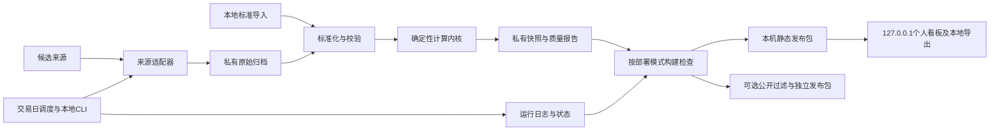

# 纳指100估值看板架构设计文档（ADD）

- 版本：1.0（定稿）
- 日期：2026-11-08
- 状态：用户已接受方案，设计定稿；软件及真实数据验收状态见§0.5
- 需求基线：[SRD v0.3](SRD.md)＋2026-11-08用户范围变更（本机个人使用可完成交付）
- 最新验证：[ADD v0.3数据实测报告](verification/add-v03-report.md)；此前机制探针不等于完整数据通过。
- 验证依据：[架构验证报告](data-feasibility.md)、[逐证券矩阵](data-feasibility-matrix.csv)；报告是v0.1验证记录，不改写其历史判定
- ADD：Architecture Design Document

## 0. 定稿决策与首版验收基线

本节记录2026-11-08用户明确接受的最终方案。首版是零数据采购预算、本机个人使用的中文估值看板：主页面引用来源公布的整体估值；研究页面逐步完善自主计算TTM；完整FY1 normalized复算延期。本节优先于下文旧阶段设计及SRD中与之冲突的交付要求。严格计算规则仍保留，用于研究计算和后续增强，不再要求先通过完整TTM/FY1才能交付看板。

### 0.1 首版范围

| 能力 | 定稿要求 |
|---|---|
| 主页面 | 展示来源公布的QQQ滚动PE及Forward PE参考卡片；每项独立显示来源、指标原名、数据日期、观察时间及口径限制 |
| 自算研究页 | 最新有证据的完整QQQ篮子＋有效价格＋逐步补齐的TTM；允许覆盖子集，显示覆盖率、缺失列表与公式 |
| FY1 | 展示来源公布的Forward PE参考；可展示有证据的逐证券预测。完整FY1 normalized自主复算不属于首版验收 |
| 更新 | 手动导入/录入为必选，周度检查为初始维护节奏；全自动日更和五交易日稳定性为后续增强 |
| 部署 | 127.0.0.1个人使用，保留本地导出；无须公网账号或再分发准入 |
| 历史 | 从实际观察时点归档，不承诺回填、严格时点回测或十年百分位 |

可选来源：Invesco QQQ factsheet的滚动PE，以及Stock Analysis QQQ页面公布的PE/Forward PE。前者说明过去12个月加权调和平均，但未充分披露项目要求的全部亏损处理细节；后者的Forward PE不能仅凭名称认定为FY1 normalized。选择来源不表示自动接入已经实现，首版允许将可核实数值及原件证据人工导入。

参考：[Invesco QQQ factsheet](https://www.invesco.com/content/dam/invesco/hk/en/pdf/factsheet/Invesco_QQQ_factsheet_EN.pdf)、[Stock Analysis QQQ页面](https://stockanalysis.com/etf/qqq/)。不把本文中曾观察到的数值硬编码为当前值。

### 0.2 引用指标的数据契约与边界

新增 `PublishedMetricObservation`：`observation_id`、`provider`、`instrument`、`metric_label_original`、`metric_kind`、十进制`value`、`unit`、`source_as_of`（可为空）、`observed_at`、`source_url`、原件哈希与定位、`period_basis`、`accounting_basis`、`loss_treatment`、`methodology_status`、`entry_mode`。无法核实的口径保存unknown，不推断。页面报价日期不能自动填作PE的数据日期；缺日期显示“来源未注明，观察于…”。

引用指标不进入自算engine，使用独立导入校验与发布路径；其上线不依赖全量证券价格、权重或盈利。来源过期不改日期，显示原日期和提醒；周度未完成检查提示更新逾期，不把月度/季度factsheet伪装为周度新数据。真实值与演示数据严格隔离。

不同来源或方法各自成序列，不拼接历史、不混算盈利增长率。来源整体PE与自算证券贡献在页面上分区，不声称自算贡献解释了供应商整体PE。首版引用卡片不衍生100元盈利解释或跨来源变化率，以免引入尚未验证的经济口径。

### 0.3 研究快照与严格历史快照分离

首版研究允许在观察时间T读取价格日D的收盘价、权重日W的篮子及T时已知财务数据。W/D/T分别展示，名称包含“观察时点研究”；周日观察周五价格不因超过原次日12:00截止而整体失效。原截止规则仅约束 `strict` 快照和历史回填，不约束该研究入口。

研究仍执行身份、单位、币种、拆股、负盈利和缺失校验，并沿用固定篮子5交易日及子集规则。未知完整篮子不生成覆盖率；子集结果不能作为全组合。最新性检查时间与财报内容获取时间分开保存。研究数据按T归档，不生成D日当时已知的回测点。

### 0.4 页面及实施顺序

默认入口改为“整体估值参考”，先呈现引用指标和来源日期；独立导航进入“自主计算研究”，再显示§9的篮子、覆盖、行业、明细及方法。研究尚无合格数据时显示具体缺口，主页面不因此整体空白。严格模式留为增强入口，不再优先占据首页。

实施顺序：引用指标schema与人工导入 → 本机主页面和观察历史 → 研究计算内核、完整篮子导入及覆盖子集 → 价格适配和TTM补证 → 可选自动调度与严格完整指标。完整FY1数据服务和公网发布不在首版关键路径。

### 0.5 定稿验收

| 验收项 | 首版通过标准 |
|---|---|
| 真实引用数据 | 至少一条真实滚动PE及一条真实Forward PE可追溯到来源原件，未知口径明确标识；无需证明二者同口径 |
| 本机软件 | 引用导入、字段校验、页面、导出、观察历史、错误和空状态通过；回环隔离及秘密保护通过 |
| 研究功能 | 公式/亏损/缺失/子集/模式隔离测试通过，真实研究输入有则显示，无则说明缺口，不用合成数据冒充 |
| 完整自算TTM/FY1 | 分别保留未完成状态，不阻塞上述首版验收 |
| 无人值守与公网 | 后续独立验收，不作为首版完成条件 |

本次“定稿”表示设计方案获用户接受，不表示应用已实现、真实引用导入已完成，或完整TTM/FY1数据已通过。旧验证报告和矩阵保留原判定。

## 1. 严格计算目标与保留设计

将 SRD 的计算、数据、展示和发布规则落实为可实施的模块、数据契约与验收边界。SRD 是需求依据；本文件中的技术选型、目录和接口为设计决策，已由§0定稿明确首版范围；候选数据源仍需逐项验证。

系统按真实证券权重汇总盈利收益率，分别计算 TTM GAAP 与 FY1 normalized 指标，为个人研究提供本地计算和中文网页，首版以本机个人使用为可接受的完整部署方式，公开网站改为可选扩展。数据采购预算为零。价格与权重日期、预测期间及数据覆盖仍参与指标判断。数据再分发权限不属于本机交付阻塞项；软件运行成功仍不能替代真实数据验收。

首版不建设实时行情服务、交易系统、用户账户系统、在线上传后台或通用金融数据平台；不生成买卖信号或没有历史依据的十年百分位。

### 1.1 本轮范围变更及证据边界

用户已明确允许仅部署本机供个人使用，因此本文件对SRD §1、§9.1、§9.4—9.5中“必须公开交付”的要求作显式覆盖：本机验收是必选，公开验收是可选。SRD AC-17和AC-UI-08的公开限制仅在选择公开模式时适用。SRD原文保留，后续实施以此范围变更为准。

报告中的100个SEC发行人响应、101只代理证券、单只价格样例和本地合成发布试验是能力证据。目标日2026-11-06的采集已超窗口，TTM/FY1合格记录均为0/101，完整权重分母未知，正式覆盖率为null；不能把它们重新标为当前有效输入。此轮仅更新设计，不代表执行了新的来源探测或解除全量数据阻塞。

## 2. 架构决策

### 2.1 方案取舍

| 方案 | 优点 | 代价与结论 |
|---|---|---|
| 本地文件计算＋手工网页更新 | 依赖少，易复核 | 保留为导入及恢复路径；不足以独立满足自动日更 |
| 离线采集计算＋不可变快照＋静态网页 | 数据与展示解耦，访客请求不触发上游访问，容易复算和控制公开字段 | 推荐；需要调度、归档及发布流水线 |
| 常驻后端＋数据库＋动态查询 | 便于多用户管理和复杂查询 | 首版数据量和功能不需要，增加运维和费用约束 |

采用第二种方案。计算只有一个权威实现；前端消费计算结果，不重新实现组合估值。公开站点不提供写接口。本地命令行承担导入、更新和复算。

### 2.2 建议技术栈

| 层 | 选择 | 边界 |
|---|---|---|
| 采集与计算 | Python、标准库 Decimal；类型化模型及 JSON Schema | 精度策略固定，核心不依赖网络；依赖版本在实施时锁定 |
| 数据适配 | SEC＋发行人原报表为TTM主路径；QQQ为显式代理候选；价格/FY1适配器与文件导入 | 按验证报告分级启用，详见§5.3及§12；不再假定单一Yahoo接口可覆盖全部字段 |
| 网页 | TypeScript、React、Vite，普通 CSS | 静态构建；没有必须使用 SSR 的需求 |
| 存储 | 私有文件归档＋SQLite 运行索引 | 文件为审计依据；索引可重建；公开站点不连接数据库 |
| 调度 | macOS launchd日历触发＋持久化任务队列 | 已有短时触发证据；长期、休眠、重启恢复待验 |
| 托管 | 默认本机127.0.0.1静态HTTP服务；Vercel可选 | 本机交付无需云账号、免费额度核查或数据再分发准入 |
| 验证 | Python 单元/契约测试、网页组件测试、浏览器端到端测试 | 工具具体版本留给实施阶段，以锁文件记录 |

Vite/Vercel 官方文档支持静态构建部署路径，但不证明当前账号免费额度、数据公开权限或调度能力满足本项目。首版不将采集放入访客请求或 Vercel 定时函数。[Vite 部署文档](https://main.vite.dev/guide/static-deploy)、[Vercel Vite 文档](https://vercel.com/docs/frameworks/frontend/vite)。

云端调度可在后续验证后使用 GitHub Actions，但不是默认前提。其定时任务可能延迟，公开仓库长期无活动还可能停用；不得把 cron 配置成功当作每日任务已执行的证据。[GitHub 定时工作流说明](https://docs.github.com/en/actions/reference/workflows-and-actions/events-that-trigger-workflows)。

## 3. 总体结构与信任边界



分为外部来源、私有归档和网页服务三个边界。本机网页读取经过结构与敏感信息检查的本机发布包，不执行再分发权限检查；可选公开包另走字段权限过滤。两类构建使用独立目录，不将工作目录或原始归档作为静态服务根目录。

### 3.1 模块职责

| 模块 | 输入与输出 | 禁止承担的职责 |
|---|---|---|
| `calendar` | 交易所日历 → 交易日、收盘时间、下一交易日及期限 | 不用工作日规则猜测休市或半日市 |
| `adapters` | 目标日与截点 → 带来源证据的原始记录 | 不用空值代替亏损，不推断 FY1 口径 |
| `identity` | 来源代码 → 稳定证券/发行人/股类及有效期 | 不把代码当永久身份，不合并不同股类权重 |
| `normalize` | 原始记录 → 标准输入 | 不通过填零修复缺失，不静默混用来源 |
| `validate` | 标准输入与政策 → 字段状态、组合约束、覆盖报告 | 不计算经过筛选后冒充完整的指数 |
| `engine` | 已校验输入 → 组合、行业、证券贡献和派生指标 | 不读取网络、当前时间或展示舍入值 |
| `archive` | 输入、结果、运行记录 → 不可变文件与索引 | 不覆盖旧预测或历史版本 |
| `publisher` | 快照＋部署模式 → 本机发布包，或经公开策略筛选的公开包 | 不将本机产物直接当作公开产物 |
| `web` | 单一快照及状态 → 卡片、表格、历史、方法 | 不重新计算权重或组合 PE |

### 3.2 计划目录

```text
apps/web/                    # 只读看板
src/nasdaq100_pe/             # calendar/adapters/identity/normalize/validate/engine/archive/publisher/cli
schemas/                     # 导入、快照、本机/公开发布包 schema
config/                      # 无凭证的方法与来源配置
fixtures/synthetic/          # 明确标识的合成测试数据
tests/                       # 单元、契约及端到端测试
docs/SRD.md
docs/ADD.md
docs/data-feasibility.md     # 已有v0.1验证报告，保留历史证据
```

私有运行根目录通过 `DATA_ROOT` 指定，置于网站构建目录之外，含 `raw/`、`inputs/`、`snapshots/`、`runs/` 和 `index.sqlite`。本机暂存目录为 `publish/local/<release_id>/`，可选公开目录为 `publish/public/<release_id>/`。配置、日志、错误栈及凭证不进入该目录。当前工作目录尚无 Git 仓库；本次只修订 ADD，不初始化仓库或创建部署资源。

## 4. 数据契约

### 4.1 统一约定

金额、价格、EPS、权重、收益率及 PE 均以十进制字符串交换，禁止 JSON `NaN`/`Infinity`。缺失用 `null`，并携带原因；`"0"` 只能表达已确认的零。日期使用 `YYYY-MM-DD`，时间戳使用带时区的 ISO 8601；归档统一存 UTC，交易日期按 `America/New_York` 解释。

`schema_version` 控制字段结构，`method_version` 控制经济口径及计算政策，`adapter_version` 控制来源映射。三者独立。方法变更、权重模式改变或会计口径改变产生新的历史序列键。

### 4.2 核心实体

| 实体 | 必需内容 |
|---|---|
| `MethodSpec` | 方法版本、权重模式、TTM/FY1定义、精度、容差、有效性/新鲜度规则、行业分类版本、估算政策 |
| `SourceEvidence` | 来源ID、原始对象ID与内容哈希、获取时间、来源时间、字段定位、适配器版本、授权评估引用；敏感 URL 参数剔除 |
| `SecurityIdentity` | 稳定证券ID、发行人ID、股类ID、代码及有效期、来源代码映射、名称、行业及行业来源 |
| `Universe` | 名单日期/生效日期、预期证券ID集合、完整性证据、来源；数量不写死 |
| `WeightSet` | 模式、日期、原权重、排除项、代理归一化系数、舍入修正系数、最终权重、名单校验结果 |
| `PriceObservation` | 证券ID、目标日、常规收盘价、币种、价格类型、拆股调整基准、来源证据 |
| `EarningsObservation` | TTM/FY1、会计口径、计算路径、EPS或利润及市值输入、币种/单位/股类范围、期间、来源更新时间及获取时间、有效状态 |
| `Snapshot` | ID、输入哈希、方法/schema版本、目标日、截点、成分/权重/价格日期、模式、真实/合成标识、证券及行业结果、两类指标状态、来源引用 |
| `RunRecord` | 运行ID、目标日、尝试槽位、开始/结束时间、阶段、耗时、失败代码、覆盖率、生成快照及发布版本引用 |
| `Release` | 发布ID、deployment_mode（local_private/public）、生成时间、按模式检查的快照、日期目录、方法说明、公开来源、清洗后的运行状态、文件哈希清单、策略版本 |

TTM 必须携带四个连续季度的起止日期及证据；直接提供 TTM EPS 的来源也须能证明覆盖期间。EPS 路径注明稀释口径和拆股基准。利润/市值路径须明确为公司或股类范围；单一股类市值不得配整个发行人利润。

FY1 保存 `forecast_period=FY1`、`fiscal_year_end`、期间识别证据、`statistic=mean`、`accounting_basis=normalized|GAAP|unknown`、`source_updated_at`（可为空）、`fetched_at`。`forwardPE` 或 `forwardEps` 字段名不是期间证据。零预测 EPS 有效，预测 PE 为零则不能推出零盈利。

### 4.3 指标结果与质量状态

每个 TTM/FY1 结果包含：

```text
eligibility: complete | partial | unavailable
quality_flags: [机器可读原因码]
valid_weight: 十进制字符串或null
coverage_ratio: 十进制字符串或null
known_contribution: 十进制字符串或null
portfolio_yield: 十进制字符串或null
pe: 十进制字符串或null
pe_state: value | non_positive | incomplete
missing_security_ids: [...]
```

只有完整名单和可信权重存在时，覆盖率才有完整组合分母；否则为 `null` 并显示“完整权重未知”。已知部分贡献不是完整收益率，不用于100元解释、完整 PE 或完整历史点。`quality_flags` 与可计算性独立：预测修订时间未知可参与计算，但必须带 `FORECAST_FRESHNESS_UNVERIFIED`，不能显示全部正常。

常用原因码：`MISSING_FIELD`、`UNKNOWN_ACCOUNTING_BASIS`、`WRONG_FORECAST_PERIOD`、`STALE_EARNINGS`、`STALE_FORECAST`、`PRICE_DATE_MISMATCH`、`WEIGHT_DATE_MISMATCH`、`UNKNOWN_UNIVERSE`、`SPLIT_BASIS_MISMATCH`、`CURRENCY_MISMATCH`、`AMBIGUOUS_SHARE_SCOPE`、`PUBLIC_USE_UNVERIFIED`。每个原因附字段、证券和来源定位；UI 使用统一中文映射。

### 4.4 导入与导出

标准导入选择 UTF-8 JSON 包，入口含 `schema_version`、`method_version`、`universe`、`weights`、`prices`、`earnings`、`sources`。导入者不能仅以 `complete=true` 跳过名单完整性和来源证据校验。未知枚举、重复ID、非法日期、数值非有限、冲突币种或无来源字段均进入诊断；结构错误拒绝导入，单条财务字段无效可产生部分数据快照。

本地导出提供完整 JSON 复算包，以及 CSV 明细＋`metadata.json` 打包下载。JSON 是计算与审计的权威格式，CSV 便于人工检查。CSV 使用 UTF-8，固定字段名与单位，防止以 `= + - @` 开头的文本被表格软件解释为公式；负数数值列按数字格式输出，文本列单独转义。

公开导出单独生成，只含获准再分发字段、模式、日期、方法和缺失说明。被删除的字段声明为 `redacted_fields`，该产物可为 `reproducible=false`；不能将不含输入的公开摘要称为完整复算包。若另行选择公开扩展但明细或指标公开权限不成立，该公开扩展只提供合成演示发布；本机真实数据包不受此限制。

## 5. 数据采集与有效性校验

### 5.1 来源策略

验证报告已表明：官方匿名权重为空表，QQQ只观测到D−1；SEC可取得发行人事实但直接季度筛查不足；Yahoo价格仅单证券探测，FY1接口有401/429。故SEC与发行人原报表升级为TTM优先路径，QQQ代理须显式配置，Yahoo保留为价格/FY1候选而非默认全量数据保证。报告中的访问条件单独记入适配器能力，不与公开再分发权限合并判断。

官方完整成分和权重为指数模式优先候选；Invesco 完整股票持仓为代理模式候选。Yahoo/yfinance 为价格、TTM 与 FY1 候选。实现分别定义 `fetch_universe`、`fetch_weights`、`fetch_prices`、`fetch_earnings` 适配接口；接口返回原始证据和时间，不承诺候选来源具备全部字段。

不能获取官方权重时，不在同一序列里自动替换为 QQQ。代理须显式选择方法，页面与导出固定使用“纳指100估值估算（QQQ股票持仓代理）”。代理完整性依据基金完整股票集合，不把其成分与指数完全一致作为未经验证的事实。

首个接入里程碑对完整名单生成字段覆盖矩阵：每证券的身份、日期、价格、TTM、FY1、会计口径、预测期间、更新时间、负盈利支持、授权证据、失败原因及权重。报告区分“接口返回字段”和“语义验证通过”，不得只验证几只大权重证券。

### 5.2 校验顺序

1. 校验输入结构、ID唯一性、稳定身份映射及完整名单证据。
2. 校验原权重非负、无重复、无遗漏，确认官方或代理模式。
3. 官方完整集合权重之和与1的绝对差≤0.0001才允许舍入修正；超过则拒绝该权重集。保存原值与系数。
4. 代理先确认完整持仓及资产类别，排除现金等非股票，保存排除项、已知排除权重及未知项（总排除权重可能为空，见§5.3）；对全部股票按股票权重和归一化。其系数与舍入修正分别保存；不能将缺失股票当作现金排除。
5. 价格必须是目标交易日D常规收盘价，检查正数、币种、拆股与盈利基准。权重须为D；D−1仅进入独立估算通道，更旧数据禁止计算当日指标。
6. D−1估算须有证据确认D−1至D无成分调整或公司行动；事件信息未知也阻止估算。此通道与同日主指标分别标识和存储。
7. 分别验证 TTM 与 FY1 的期间、会计口径、单位、股类/发行人范围及新鲜度；不合格记录不进入对应完整指标。
8. 计算覆盖、缺失原因和质量标记，交给计算内核。

TTM 最新季度结束距D≤180自然日，并须为来源当时最新四个连续季度。FY1 来源修订日期已知且距D>30自然日则无效；来源修订时间未知允许新获取的现值，保留质量标记。每次运行重新获取财务和预测；重试可复用同一采集批次中未满24小时的有效缓存；财报不可变内容的复用与每日最新性复核按§13.4执行。获取时间与修订时间绝不互相代填。

来源时间晚于数据截点的记录不能进入该快照。采集截止时间内取得的收盘后盈利信息可以使用，但快照必须标记为“收盘后估值快照”，不能声称具备严格收盘时点回测资格。

### 5.3 TTM补证、身份与候选输入处理

**SEC主路径。** 按发行人CIK获取事实一次，再映射到各证券；CIK只证明发行人，不证明股类或ADR口径。先筛选直接已报告的单季GAAP稀释EPS，保留期间、单位、form、accession、申报日期、接收时间、实际可得时间和获取时间。季度边界由财年披露确定，报告使用的77—105天仅是探测筛选参数，不能排除合法的特殊财年或取代连续性判断。

**季度补证。** 缺季时定位对应10-Q/10-K、8-K/6-K附件及发行人业绩公告，优先提取明确的单季已报告值；人工补录必须关联原文件哈希、页码/表格/单元位置、录入时间和复核结果。自动解析不确定时保留待核状态，不能自动选择看似最接近的数字。报告的AAPL Q4与MRNA负EPS作为回归样例，但其截止后取得的本轮数据不得直接成为11-06历史点。

**禁止差分EPS补季。** 稀释EPS的加权股数和舍入不具备简单加减关系，不用“全年EPS−九个月EPS”推出Q4，也不用“年度EPS＋当年累计EPS−上年同期EPS”当作已报告TTM。首版默认使用四个明确已报告单季EPS加总，保存 `calculation_path=reported_quarter_eps_sum`；AAPL的8.97与全年8.98差异记录而不强制抹平。来源直接TTM或全年路径须另有期间及口径验证，若采用则另定方法版本和路径优先级，不能为补缺而静默替换。利润可加减的路径也只能在相同主体、会计口径、单位和期间证据成立时使用，并要求匹配公司总市值；不能把推导利润除以不匹配股类市值。

**股份和币种。** `SecurityIdentity`补充CIK/CUSIP/来源标识、股类生效区间及ADR换算证据；CUSIP用于交叉核对，不替代内部永久ID。EPS记录增加 `split_basis_date`、`share_scope`、`adr_ratio`（适用时）、`currency`和转换证据。外币EPS优先寻找已报告且匹配证券的USD/存托凭证值；需换汇时保存汇率来源、日期、方向与方法版本，未完成方法验证前该行无效，不直接用ASML非USD EPS除以USD价格。拆股前后EPS/价格必须在同一基准，多股类共用EPS必须有权利及口径证据。

**权重排除项。** 完整股票权重集合与非股票排除项分别验证。报告观测的101只股票权重齐全时，可据其股票权重和定义代理归一化；非股票权重null保留未知，记录 `known_excluded_weight`、`unknown_excluded_items`，`total_excluded_weight=null`，不能把0.168071%的已知净值称作全部排除权重。若资产类别未知或股票可能遗漏，则整个代理权重集不合格。使用这条政策不改变D日权重要求。

**输入状态。** 来源返回成功、候选标准化、语义合格、日期合格是四个独立状态。增加 `accepted_at`、`available_at`、`observed_at`、`evidence_status`、`reviewed_at`和 `acquisition_mode=adapter|user_import`；不得用filed日期代替实际可得时间。缓存可按原文件哈希去重，但每次日更仍重新确认是否有新增披露；只重新读取本地缓存不刷新获取时间。修订和补证保留旧版本。

**FY1人工路径。** 标准导入须逐证券保存原文预测期标签、下一财年判定依据、财年结束日、EPS均值、normalized证据、币种/股类、来源和获取截点。手工补录可以补接口缺口，但不豁免24小时获取政策；101只分数天录入不能成为同一日完整FY1。没有修订时间仍按SRD允许新获取现值并标记新鲜度未验证。单页出现normalized切换按钮不能证明另一个API字段具有该口径。


## 6. 计算内核

### 6.1 数值政策

从原始十进制文本构造 Decimal，固定34位有效数字和 half-even 舍入模式。计算前不做显示舍入；确定性遍历按稳定证券ID排序。导出保留计算值及政策版本，前端只格式化。数值单元验收绝对误差≤1e−10，权重归一化容差另按0.0001执行。

输入路径优先选择已验证的 TTM 稀释EPS/价格及 FY1 EPS/价格；口径匹配的利润/市值或有充分元数据的非零PE可作为明确记录的路径。多个路径都存在时记录交叉核对差异，不静默混合取平均；冲突不能解释则该记录无效。

### 6.2 证券与组合

```text
有效非零PE：y_i = 1 / PE_i
匹配EPS与价格：y_i = EPS_i / P_i
匹配利润与市值：y_i = E_i / M_i
贡献：c_i = w_i × y_i
已知部分贡献：K = Σ有效证券 c_i
有效权重：C = Σ有效证券 w_i
完整时：Y = Σ全部证券 c_i
完整且Y>0：PE = 1 / Y
完整且Y≤0：保留Y，PE=null，pe_state=non_positive
不完整：portfolio_yield=null、PE=null，保留K、C和缺失列表
```

完整性按“全部证券对应盈利有效”判断，不仅比较覆盖率是否四舍五入为100%；零权重证券缺失也须记录且不绕过SRD的全成分规则。亏损收益率保留负号；已知零EPS配有效价格得到零收益率且计入覆盖，个股PE无意义。负个股PE允许展示并标“亏损”，组合或行业盈利非正则显示N/M。

### 6.3 行业与市值

对每行业计算 `W_s=Σw_i`、`C_s=Σ有效w_i`、`K_s=Σ有效w_i×y_i`。行业成员盈利全部有效且 `W_s>0` 时，`Y_s=K_s/W_s`；`Y_s>0` 才有行业PE。行业不完整时只显示已知贡献和覆盖，不生成完整行业PE；行业权重为零时PE为空并解释。分类缺失进入“未分类”。

组合完整时，各行业贡献加总须等于组合收益率，各行业权重加总为1；不完整时核对各行业已知贡献与组合已知贡献一致。贡献展示单位为百分点，数值为 `100×c_i`，不可与个股自身收益率混淆。

公司总市值单独计算：按发行人去重，要求每个发行人的完整公司市值为目标日同一币种及口径。一个发行人多个来源值不一致时不得任取一条；缺失、币种不统一或范围未证实时总市值卡片不可用，但不因此阻止已具备EPS/价格的组合估值。公司市值不作为组合加权算法的替代权重。

### 6.4 派生指标

完整且对应收益率有效时，展示 `100×Y` 的100元解释，负数明确为对应亏损。不完整时隐藏该句。只有两种收益率都为正才计算候选变化：`Y_F/Y_T−1` 与 `PE_F/PE_T−1`。前者另要求会计口径明确可比，默认GAAP/normalized隐藏；后者若展示必须同处标注“不同盈利口径下的估值差异”。比较还要求同一权重和价格快照，不表述为投资回报。

## 7. 调度、归档与发布

### 7.1 调度政策

v0.3增加来源感知的次日补采槽（§13.2），原三个槽不再是全部尝试时点。正式截止仍不变。

本机使用launchd的 `StartCalendarInterval` 在每小时00、15、30、45分触发轻量任务，基于已验证交易日历判断到期槽位；不在进程内睡眠数小时。交易日D的槽位为实际收盘后90分钟、3小时、6小时。首次成功且两类指标完整后不再请求当日重试；采集失败或存在可补齐的部分数据时，在后续槽位继续尝试。

日历保存版本及来源证据，包含休市、半日交易、夏令时和临时调整。日历未知或过期时停止自动生成新日期并报告原因。机器恢复后执行最近一个已到期未完成槽位，合并错过的重试，记录真实启动时间；不会用当前预测补造错过的历史日。已归档当时输入的复算另走 `recompute`。

延迟采集截止采用设计默认值：D后一个自然日纽约时间12:00（不是下一个交易日），写入方法政策。截止前允许补跑并保存真实截点；超过截止的槽位记为 `missed_window`，禁止使用此后新获取的盈利/预测创建D日历史快照。例如周五任务错过后周日恢复，跳过周五采集，报告历史缺口。`collect --date D` 同样执行此检查；历史回填只能使用可证明在该日允许窗口内已经取得的归档输入，并经单独历史证据校验。该截止是首版设计选择，不是供应商保证。

同一目标日、模式和方法只允许一个活动写任务，锁记录有租约；恢复孤立任务前检查进程及租约。任务完成状态持久化。下一交易日收盘后6小时仍无新的成功快照时，原数据标记更新逾期；部分数据不等于两类指标全覆盖，UI另列每类最近完整日期。

### 7.2 运行状态与部分数据

运行状态顺序为 `planned → collecting → validating → calculating → archived → publishing → published`。每阶段可进入 `failed`；无需更新的重复运行进入 `no_op`。传输失败、完整名单/权重结构错误、缺少当日价格集等整批错误不发布新计算快照。结构可信但部分盈利字段缺失可归档并发布“部分数据快照”，完整指标为空。

自动任务使用独立的采集队列和发布队列。默认 `deployment_mode=local_private`、`auto_publish_local=true`、`auto_publish_public=false`；`scheduler tick` 在归档成功后自动构建本机包、检查HTTP读取并提升本机版本指针，不检查公开权限。只有显式选择public且公开策略通过时，才执行云端构建和部署。两类指标完整只停止采集重试，不停止发布重试。发布失败复用同一归档快照及策略版本，每次tick检查退避计划（15分钟、60分钟、180分钟，此后每6小时），无需重新抓取；仅公开队列的权限拒绝进入 `blocked_policy`，待策略更新后恢复，避免反复部署。每个目标发布记录尝试次数和下一次重试时间。发布按序列键、目标交易日和单调递增的 `revision_seq` 排序；每个日期的推荐修订在归档事务中确定。提升指针采用发布锁及原子比较更新（CAS），队列任务必须仍是该日期的推荐修订，且不早于当前默认日期/修订；同日旧修订和被supersedes替代的任务进入 `superseded_no_op`，不得因迟到重试回退。显式人工回滚使用独立操作和审计记录，不通过普通队列降版本。失败状态发布也使用此队列，但不能将状态发布成功写成快照发布成功。

新部分快照与上次完整快照并存，日期选择可浏览二者；不把旧完整PE填入新快照卡片。默认最新日期展示当前质量状态，并提供“上次完整快照”链接。运行成功、指标完整、本机发布成功及可选公开发布成功分别记录，互不替代。

### 7.3 幂等与更正

规范化输入按稳定ID排序、统一时间与十进制表示，生成 `input_hash`。计算身份由 `input_hash + method_version + engine_version + schema_version` 的内容哈希确定；运行ID和运行开始时间不参与结果身份。原始获取时间及截点属于输入证据；同一已归档输入复算才是同一身份，重新采集产生新输入不强行去重。

快照文件不可变。内容不同的更正产生新ID，带 `supersedes_snapshot_id`、更正原因与时间；日期目录指定当前推荐版本，旧版本仍可追溯。方法、权重模式、同日/滞后估算及真实/演示构成不同序列，不跨序列覆盖。

### 7.4 原子发布与恢复

1. 在私有暂存区完成输入、质量报告、计算和哈希校验；文件写入完成后原子重命名。
2. 写入 SQLite 索引事务。崩溃后按文件manifest恢复索引；孤立暂存文件不视为成功快照。
3. 按部署模式构建：本机包不执行再分发过滤，公开包按公开策略逐字段筛选；生成自包含 `release_id` 目录：日期目录、快照、历史、方法和运行状态都指向同一发布版本。
4. 两类包均检查schema、哈希、引用完整性及敏感信息；仅公开包额外检查再分发策略。先产出完整静态包，再发布到所选目标。
5. 只有对应目标的部署验证通过才更新该模式的版本指针；失败保留原发布，记录失败，禁止逐文件覆盖造成混合版本。

失败提示采用独立、经清洗的运行状态文件，绑定最后成功发布ID和目标日；可通过不改变快照的状态发布更新。若托管服务本身不可用，无法保证即时显示新失败原因，恢复后补发。两类发布包内均附未来交易日更新期限，浏览器可据此计算逾期；超出日历有效范围时显示“更新时效未知”，不猜测交易日。

保留最后成功发布包以便回滚。每日备份私有归档、索引、方法和身份映射到独立本地备份位置，并定期用归档重建索引；备份位置未配置时明确标为未具备恢复保障，不声称已有异地备份。

## 8. 本机部署边界与可选公开模式

### 8.1 本机个人使用（默认）

本机HTTP服务由独立于采集tick的launchd用户Agent管理，登录时启动、进程退出后重启。首次无release也可启动并返回明确空状态及健康检查；存在候选release时先通过该版本路径读取并校验，再原子提升默认指针。服务未就绪时发布队列按既定退避重试，不丢弃归档、不重新采集。用户退出登录或机器关机时不承诺运行；重新登录后两类Agent恢复，并按截止窗口判定遗漏任务。未配置服务Agent时手动serve可满足手动使用，但不能通过无人值守验收。

服务只绑定 `127.0.0.1`，不绑定 `0.0.0.0`，不启用局域网共享、公网隧道或云端同步。允许的Host仅为localhost及回环地址，资源不配置跨域开放；服务根目录只包含本机发布包，无目录遍历或原始归档浏览入口。导入、更新和配置仍走本地CLI。前端资源本地打包，不添加第三方分析或上传数据。

本机JSON、CSV及页面读取不视为公开再分发，不因 `public_* = unverified/denied` 阻止构建、显示、导出或本机交付。不将报告中的公开权限状态改为allowed，只在本机模式不执行这组门槛。数据来源访问、认证、自动采集方式与数值有效性是不同事项；401/429或未确认的输入不能靠切换本机模式变成可用数据。报告中的本地自动访问限制按具体适配器路径处理，可改用适用的用户下载/标准文件导入；手工导入也不自动证明字段口径正确或已获得来源访问许可。

### 8.2 可选公开模式

本节只在未来选择公网部署时执行，不列入本轮必选交付及阻塞项。

来源策略包含 `local_processing`、`public_display`、`public_derived_metrics`、`public_download` 四类权限，分别记录 `allowed|denied|unverified`、依据链接、适用字段、核查日期和有效期。公开产物只有对应public权限为 `allowed` 的字段可进入；权限过期视为待复核。local_processing记录来源获取方式，与public门槛分开管理。此记录是项目发布控制，不代替法律结论。

来源许可未验证时可做合规边界内的本地可行性工作，公开站只能使用明确标识的合成数据或已获准数据。显示权不自动授予下载权；浏览器可获取的JSON本身也属于公开披露，不能只隐藏下载按钮。不同来源的派生结果也须单独确认公开依据。

### 8.3 两种模式共用的安全要求

凭证仅存本地受控配置或部署平台秘密存储，不使用前端构建环境变量传递秘密。日志使用允许字段列表，清洗URL、响应头、令牌及原始异常内容。导入文件限制为本地JSON、最大20MiB（设计默认），不执行文件内容或从导入字段任意访问URL。网页对来源文本转义，链接限制为许可的HTTP(S)地址。

公开站无导入、更新、配置或管理API；需要保护的管理网页不在首版范围。构建检查覆盖静态文件、source map、导出包和错误报告，禁止受限原始归档进入公开仓库或部署产物。

## 9. 网页设计与交互契约

### 9.1 数据读取与组件

页头常驻“本机个人使用”或“公开站点”部署模式标识，并另列真实/演示数据标识。网页先读取发布manifest，再取该版本的日期目录及所选快照。`SnapshotProvider` 将加载结果校验后一次性提交给全部模块。日期切换使用请求序号或取消机制，迟到响应不得覆盖较新选择；加载时使用骨架，或明确保留旧日期整屏状态，不出现新日期标题配旧数值。

组件按SRD固定顺序组织：

```text
Header（名称、模式、日期、导出、价格/权重/成功时间）
QualityBanner（TTM/FY1分别覆盖、失败/逾期、详情入口）
OverviewGrid（数量/市值 → TTM/FY1收益率 → TTM/FY1 PE）
EarningsExplanation（100元说明、GAAP/normalized差异）
SectorView（权重条、两类PE、整体贡献）
ConstituentTable（搜索/筛选/排序/展开详情）
HistoryView（真实日期范围、分段趋势及等价表格）
MethodAndSources（公式、方法版本、来源、时间和限制）
```

宽度≥360px保持两列三行，TTM在左、FY1在右；低于360px按数量、市值、TTM收益率、FY1收益率、TTM PE、FY1 PE单列。最大内容宽度1280px；浅背景白卡片、蓝色交互强调，不设PE红绿估值阈值。正文至少14px、核心数值28—40px、常用触控目标至少44×44px。

### 9.2 展示和筛选

PE两位小数加“倍”，收益率/权重两位百分数；极小非零值使用“<0.01%”或带负号的区间表达，详情提供精确值。缺失显示“—＋原因”，组合非正盈利显示“N/M（盈利非正）”，负个股PE标“亏损”。所有时间注明时区，纽约交易日与本地时间明确区分。

表列固定为序号、名称/代码、权重、TTM PE、FY1 PE、TTM贡献、FY1贡献、状态。详情包含输入、来源、期间、预测财年结束日和时间戳。默认按权重降序，全部证券可浏览；搜索名称/代码、行业和状态筛选只影响明细和计数，不改变全组合卡片。

数值排序使用原始精度值，空值始终置底；同值按证券ID稳定排序。非正组合/行业PE不进入低估值排名。行业点击同步明细筛选并提供清除入口。表格内部滚动、表头固定；手机名称列固定并显示横滑提示，页面本身不横向溢出。排序按钮、日期、筛选、详情均可键盘操作，焦点可见，状态含文字。

### 9.3 历史与异常

历史按 `(method_version, weight_mode, estimate_mode, data_mode)` 分段，TTM/FY1各自保留有效区间。使用交易日历识别预期交易日缺口；正常周末休市不是数据缺失，缺失交易日则断线。每段至少两个有效数值点才绘图，N/M和不完整结果不作为数值点；零点显示空状态，单点显示积累提示。

首次无快照时说明原因，不显示示例数值。演示标签在页头常驻，导出携带模式。加载失败保留可核实的上一快照及其日期并展示失败，禁止刷新时间冒充数据更新时间。本机导出按本地范围生成；仅可选公开模式下，公开权限不允许的导出项不生成文件，按钮解释不可用原因。

## 10. 本地操作接口

以下为实施目标，不表示命令目前已存在：

| 命令 | 行为 |
|---|---|
| `ndx-pe collect --date D --method METHOD` | 执行采集、校验、计算与私有归档；不默认公开发布 |
| `ndx-pe import --file INPUT` | 校验标准JSON并通过同一计算管线归档 |
| `ndx-pe validate --input INPUT` | 输出结构、语义和覆盖报告，不发布 |
| `ndx-pe recompute --snapshot ID` | 使用固定归档输入与指定版本复算 |
| `ndx-pe export --snapshot ID --scope local` | 生成完整复算包与CSV明细 |
| `ndx-pe build-local --snapshot ID` | 生成本机包；检查结构和秘密泄露，不检查再分发权限 |
| `ndx-pe serve --host 127.0.0.1` | 只读服务本机发布目录，显示部署模式与真实/演示标识 |
| `ndx-pe build-public --snapshot ID --policy POLICY` | 生成经过权限过滤的发布包；未知权限拒绝受影响内容 |
| `ndx-pe scheduler tick` | 处理到期采集与独立发布队列；按配置完成自动构建、部署及验证 |
| `ndx-pe status` | 最近尝试、最近成功、各指标完整日期、发布与失败状态 |

退出码设计：0=操作完成（允许明确部分数据），2=输入/配置错误，3=采集失败，4=整批质量校验失败，5=可选公开权限阻止公开目标发布（不影响本机队列），6=存储或部署错误。机器可读JSON结果必须另含 `completeness` 与 `publication_status`，不能仅靠退出码0宣称全量验收。

## 11. 验证与需求追踪

### 11.1 测试层次

- 公式：采用SRD合成用例验证权重收益率、负盈利、零盈利、缺失、行业加总、跨口径派生隐藏与Decimal精度。
- 数据契约：单位/币种/拆股、发行人多股类、季度连续性、FY1财年及会计口径、预测更新时间未知、权重模式和归一化政策。
- 流水线：半日市、夏令时、休市、延迟执行、24小时缓存、重复运行、并发锁、崩溃恢复、重试、原子发布与回滚。
- 发布安全：本机模式不因public权限未知而失败，回环绑定、Host检查及本地资源隔离通过；可选模式未验证权限阻止公开，脱敏及字段白名单，公开JSON与导出一致遵守范围，演示与真实历史隔离。
- 网页：320/390/768/1440px、日期切换竞争、筛选排序、固定列、键盘操作、状态文字、历史断点与空状态。
- 真实数据：完整名单字段覆盖矩阵与样本原始证据核对；这一步必须真实运行，合成测试无法代替。

### 11.2 SRD对应表

| SRD要求 | 设计落点 | 验证 |
|---|---|---|
| FR-01、UI-01—06 | §4.3、§6、§9.1—2 | AC-01—05、AC-10、AC-UI-01/04/05 |
| FR-02、UI-07—09 | §6.3、§9.2 | AC-08、行业缺失和零权重测试 |
| FR-03、UI-10—13 | §4.2、§9.2 | AC-07、AC-UI-03/07 |
| FR-04、UI-16 | §4.1—2、§9.1 | 方法/来源可追溯检查 |
| FR-05、UI-14—15 | §7.3、§9.1/9.3 | AC-16、AC-UI-02/06 |
| FR-06、UI-17—18 | §7、§10 | AC-09/11、故障恢复测试 |
| FR-07、UI-19 | §4.4、§8、§10 | 导入复算一致性、AC-UI-08 |
| FR-08 | §4.3、§5、§9.3 | AC-03/06/13/14/15 |
| UI-20—23 | §9 | AC-UI-01/07、可访问性检查 |
| 官方/QQQ与公开边界 | §5.1—2、§8 | AC-12/17、AC-UI-05/08 |

AC-01 的1.6333%作为计算核对精度，概览按UI-04显示1.63%；详细计算或验收报告显示1.6333…%。这样同时保留公式验收精度与页面格式约定。

### 11.3 性能与运维验收

设计测试环境：固定版本Chromium，390×844视口，冷缓存，4倍CPU降速，10Mbps下行、1Mbps上行、100ms RTT；约110条合成证券记录，保存测试机器与浏览器版本。首屏LCP目标≤3秒，进行5次测量并报告中位数及最差值，目标要求每次≤3秒。历史按需加载，首屏只请求当前快照；首屏压缩传输预算500KiB为设计目标，实施后实测调整须记录理由。

每次运行记录阶段耗时、请求成功/失败数量、TTM/FY1有效权重、缺失原因分布、重试与发布状态。日志不含凭证和受限原始响应。状态页显示最后成功数据与最近失败，不能用任务心跳代替数据新鲜度。

## 12. 严格模式验证记录与阻塞项解决方案

本节保留v0.2阶段计划及数据门槛；首版交付顺序和完成判定以§0为准。

### 12.1 实施顺序与交付层次

1. 先实施本机闭环：schema、计算内核、JSON导入、快照归档、回环看板及导出，以合成数据完成软件验收。
2. 在未来开放采集窗口内验证完整QQQ权重和全量价格，接入SEC及发行人季度补证；先争取独立的真实TTM完整快照。
3. FY1单独开展来源契约与全量覆盖验证；不阻止TTM模块和本机软件交付，不以其他预测口径替代FY1。
4. 用真实运行验证launchd、日历、休眠及失败恢复；历史从各指标首个合格快照分别积累。
5. 公网发布仅在另行选择时实施，不要求Vercel账号或再分发核查来完成本机交付。

软件可先交付不等于全量真实数据目标已完成。以下“解决方案”是可执行路径及验收条件，不是已经解决或保证免费来源一定存在。

### 12.2 阻塞项处置矩阵

| ID / 验证报告依据 | 影响范围与当前判定 | 解决方案 | 解除条件 / 失败后的行为 |
|---|---|---|---|
| B-01 同日权重（§1） | 阻塞完整真实组合；官方无明细，QQQ仅D−1 | 首版显式选择QQQ代理；在新D的三个槽位及截止前补采完整持仓，按effectiveDate校验，不用daily参数名推断日期；可导入同日完整下载文件 | D日完整股票集合、权重、日期及来源证据齐全才计算；仍只有旧日期则保持不可用。官方模式延期，不购买数据 |
| B-02 全量收盘价（§1） | 阻塞完整真实组合；仅AAPL能力样例 | 建立逐证券价格适配器及标准文件导入；在新D窗口内采全篮子，校验常规收盘、币种、单位、股类/ADR与拆股基准；401/429按来源退避，不通过反复请求绕过认证 | 全名单价格通过且输入在窗口内；任一缺失不拼旧价格，完整指标不发布，显示诊断 |
| B-03 TTM补齐（§3） | 阻塞完整TTM；100发行人响应不等于101证券可算 | SEC事实→原始申报/8-K附件→发行人已报告季度，按§5.3补证；身份映射与单位调整和价格一并校验 | 全证券最新四季、GAAP、普通股稀释口径及基准通过；否则仅已知贡献，不把缺季填零 |
| B-04 FY1（§2） | 阻塞完整FY1，不阻塞TTM或软件 | 先做期间、normalized均值和访问方式的小样本契约；候选通过后扩至全篮子；提供含证据的本地导入和逐证券补录路径。Alpha Vantage标准配额不足全篮子日更，不采用跨天轮询拼完整当日快照 | 每只证券FY1财年结束日、均值、口径与24小时获取政策均通过；不存在合格免费全量来源时保持“FY1未完成”，不承诺通过，不用NTM/forwardPE替代 |
| B-05 事件全覆盖（§4） | 仅阻塞D−1估算 | 首版关闭D−1估算，只使用同日权重；不再把完整事件流作为所有软件工作的前置条件。证券自身拆股/股类验证仍必需 | 同日路径无需证明前一日无事件；估算通道仅在完整事件证据通过五类测试后另行启用 |
| B-06 调度与恢复（§6） | 阻塞无人值守可靠性验收，不阻塞手动本机使用 | launchd日历触发、持久化槽位、截止窗口检查；连续5个交易日运行并测试休眠、退出登录、重启、锁过期、失败重试 | 五日日志及故障用例通过；机器不可用时明确missed_window/逾期，恢复不伪造历史 |
| B-07 历史（§7） | 无可回填点；不阻塞当前指标和本机软件 | 正式历史从首个合格TTM/FY1点分别归档，空历史显示积累提示；SEC旧财报只作单项证据 | 每个历史点完整输入及当时证据通过；当前预测、晚披露NPORT或当前权重不回填 |
| N-01 再分发权限（§5） | 本机模式非阻塞，移出必选准入 | 本机个人服务与导出，不公开数据；保留报告的权限记录供可选公网模式使用 | 本机完成无需解除public_*状态；只验证回环隔离及本地功能 |
| N-02 Vercel（§6） | 非阻塞，移出首版依赖 | 使用本机HTTP和本地原子发布；不创建云账号或依赖云额度 | 本机HTTP、版本切换与回滚通过即满足部署部分 |

B-01和B-02是完整指标的共同前置条件；B-03和B-04分别控制TTM与FY1。没有合格完整权重时覆盖率仍为null，而不是0%。文件导入解决接入路径，不自动解决获取时效、数据真实性或全量覆盖。

### 12.3 本轮新增验收用例

| 用例 | 预期 |
|---|---|
| local_private模式，public权限未知或拒绝 | 本机构建、浏览和本地导出不被阻止；不产生公网包 |
| 只绑定回环、错误Host、目录穿越请求 | 非允许访问被拒绝，归档和秘密不暴露 |
| QQQ权重日期仍为D−1，事件证据未知 | 不启用估算；旧快照保留，当前完整指标不可用 |
| 股票权重全有，非股票排除项一项权重未知 | 可按完整股票和定义代理，逐项披露未知排除值；净排除总权重为null，不把未知当零 |
| AAPL四季EPS合计与年度EPS不同 | 保存两条证据及路径；默认四季加总，不静默用年度值覆盖，不用年度减九月EPS推Q4 |
| MRNA季度为负；GOOG/GOOGL共享CIK；ASML非USD输入 | 保留负值；股类分别校验；未证实币种/ADR换算的输入无效 |
| FY1来源只返回forwardPE或缺normalized依据 | 对应FY1无效，TTM不受其牵连 |
| 同日新修订已发布、旧修订随后重试 | 旧任务superseded_no_op，版本指针不回退 |
| 无release首次启动、服务崩溃及重新登录 | 空状态可读、服务恢复、发布独立重试；采集仍执行截止政策 |
| 本机发布失败但已采集完整 | 复用归档独立重试，不再抓取、不覆盖最后成功包 |
| 截止后补录昨日权重或当前预测 | 不生成昨日正式历史点；仅诊断记录或显式非验收研究输入 |

### 12.4 当前验收状态

| 验收轴 | 完成依据 | 当前状态 |
|---|---|---|
| 本机软件 | 公式、契约、导入导出、UI通过，数据可复算 | 应用未实施；可进入开发 |
| 本机部署 | 回环服务、模式隔离、版本切换与回滚通过 | v0.2的11组机制探针通过，应用部署待验 |
| 完整真实TTM | 同日完整篮子/权重/价格及全部TTM口径通过 | 未通过，B-01/02/03仍待数据验证 |
| 完整真实FY1 | 共用前置条件及全部FY1期间/口径通过 | 未通过，B-01/02/04仍待数据验证 |
| 无人值守更新 | 连续运行与休眠/重启/故障恢复通过 | 短时触发、崩溃恢复及Agent重载已验证；真实登录/休眠/重启及五交易日待验 |
| 公开真实数据 | 仅选择公网扩展时验收 | 首版不适用，不阻塞本机交付 |

报告和CSV保留原观测值与旧准入结论。本版仅调整交付范围、数据接入设计和处置路径，不把设计方案记为实测成功。

## 13. v0.3 数据解决路径与研究折中

本节依据[最新v0.2验证报告](verification/add-v02-report.md)修订。正式模式沿用§5—7的完整性和时间规则；本节新增的研究模式是对既有“仅正式指标”设计的显式扩展，只用于本机研究，不算SRD完整指标验收。原报告及矩阵不改写。

### 13.1 新证据与状态

11组机制探针通过，包含实际HTTP隔离、进程崩溃恢复及Agent重载；不等于生产应用、SQLite并发事务、UI、休眠/重启、真实重新登录或连续五交易日通过。101证券/100发行人的留存SEC哈希核对通过，仍仅有AAPL/MRNA等样例。正式TTM/FY1均未获得合格全篮子输入，覆盖率仍为null。Massive和Alpaca无凭证请求401表示尚未完成接入，不能推断服务没有所需数据。

### 13.2 价格接入与次日补采（B-02）

采用“Alpaca SIP优先试验、Massive次日数据备选、标准文件导入兜底”的顺序。候选能力来自新版报告§价格候选，本轮未进行新的认证或全量探测。第一步是取得用户可用的免费账户凭证并存于本地秘密配置，禁止使用demo响应代替全量验证；缺凭证时先实施导入和适配器契约，记为 `awaiting_credentials`，不反复匿名请求。

Alpaca适配器显式请求SIP及调整政策，核对历史时间覆盖和每代码响应，不用IEX单市场数据静默替代。Massive适配器先用个股日结验证常规收盘定义，再核对批量字段。两者均需检查缺失、停牌、上市变更、币种、股类、拆股与常规时段；不能拿盘后价格、上一笔任意成交或只带close名称的字段直接验收。若候选服务只有某种日线收盘而未证明符合项目收盘口径，则保留来源口径的研究数据，不进入正式组合。

新增来源可用时间字段 `available_after`、`next_attempt_at` 和 `waiting_source` 状态。保留收盘后90分钟/3小时/6小时槽；另启用D后一个自然日纽约00:15、06:15、11:15三个补采槽，统一由15分钟tick执行，截止仍为12:00。Massive在零点前记为等待来源，不把预期未开放计为网络故障。截止后拒绝新正式输入。半日市同样使用次日补采槽；实际来源休市/周末行为须实测，不能由时间表假定数据已到达。

补采复用同日已验证且缓存未满24小时的输入，重新确认最新盈利/预测与来源可用性；固定最终截点后生成新快照，不拼成虚假的早槽成功。部署延迟不改变采集时间。免费请求额度、每分钟限制和可批量代码数作为适配器配置，在认证接入时实测；不足则排队至窗口内或转人工导入，超窗保持未完成，不自动付费。

### 13.3 权重：先追同日，再提供固定篮子研究（B-01/B-05）

正式路径在新增补采槽检查QQQ的真实生效日期、完整股票集合与权重。连续五个交易日记录来源日期推进及最早可得时间，决定是否能稳定服务D日窗口。若持续只有D−1，不能靠延长标签或改名解除正式指标阻塞，也不以未来得到的同日文件伪装窗口内观测。

可选研究路径 `profile=fixed_basket_research`：固定一个有完整证据的QQQ股票篮子和权重日期W，使用目标价格日D及观察时已知盈利。名称为“QQQ历史权重固定篮子研究”，始终列出W、D、盈利观察时间和W至D的交易日差；只允许W≤D且最多滞后5个交易日（设计保守上限，方法版本化）。直接使用固定权重，不声称模拟买入持有、不按价格漂移推导真实基金权重、不声称D日QQQ或纳指100估值。无法核对证券身份/拆股基准的记录仍无效；已知退市、并购或无法定价的证券不删除后重新归一化。

该路径不需要证明“W至D基金和指数完全没有事件”，因为估值对象明确定义为旧篮子，而非D日真实组合；但其与当前指数的差异无法给出误差界限，显示 `index_comparability=unverified`。默认正式卡片保留为空，研究结果放入独立区域，需显式选择研究模式。超5交易日只保留历史浏览，不生成新的研究指标。

### 13.4 TTM：事件驱动补证，降低每日人工负担（B-03）

先按缺口类型而非只按权重排序：缺Q4、缺季度标签、币种/ADR、股类映射、过期财报分别进入补证队列；权重用于队列内优先级，不作为剔除低权重证券的理由。以原始申报/业绩公告补齐最新四季，建立可复用的发行人解析规则和逐证券例外清单。首次补证可能需要人工，后续只处理新增披露、重述及身份变化。

财报事实未变时复用已验证值，但每日重新查询并记录是否出现新披露。新增 `checked_at` 与 `content_fetched_at`：新查询证实仍为来源最新记录才更新checked_at；离线重读不刷新时间。方法政策明确24小时检查的是最新性核验，原始财报内容可以更早取得，仍保留哈希和首次获取时间；这是对§5缓存措辞的澄清，不允许长期不查新财报。季度180天限制不变。

四季加总继续作为默认路径，禁止EPS差分补Q4。年度EPS或利润/公司市值仅在独立方法和完整口径验证后采用，不混入默认序列。优先交付真实TTM，FY1的不可用状态不阻止TTM上线；全量TTM仍不能由两个样例推定。

### 13.5 FY1：承认完整覆盖未知，提供有限但真实的研究结果（B-04）

首版不承诺零预算日更的完整FY1已可实现。先以代表性证券验证免费来源/用户已有导出：不同财年、负预测、多股类、ADR都需覆盖；只有预测财年、normalized均值、币种及来源证据通过后才扩到全篮子。不因为放弃公网部署就将未知口径认定为normalized。

折中一为“仅TTM完整指标＋FY1逐证券明细”：沿用已知贡献和缺失列表，不需要降低FY1口径要求，可作为首版本机功能交付，但完整FY1仍标未完成。

折中二为可选 `covered_subset_research`：对有效FY1证券集合S，C=Σ有效w，K=Σ有效w×y；C>0时显示子集收益率K/C，K/C>0时显示子集PE=C/K。必须有可信、完整的所选篮子权重作为分母，不能在未知完整权重时计算覆盖率。名称为“已覆盖证券子集FY1估值”，同屏显示覆盖权重、证券数、被排除列表及“并非全指数”；不设置达到95%就视为完整的阈值，不填入主卡片、不外推缺失证券。选择偏差无可证明误差界限，不能宣传为接近完整指数的估计。

折中三为显式 `weekly_observation_research`，用于人工或限额来源：允许各证券获取时间最多相差7自然日，每条展示获取时间和年龄，超过7日失效；已知预测修订超过30日仍失效。该模式只放宽研究数据获取年龄，不放宽FY1期间、normalized或单位要求，名称含“非同步周度观察”。这可降低录入压力，但不保证任何候选免费账户具备全量权限或字段，尤其不能把Alpha Vantage demo或额度足够等同于完整口径。不能用于严格日更历史或盈利增长比较。

### 13.6 模式隔离、可复现性与验收

新增 `analysis_profile=strict|research`、`basket_policy=current|fixed`、`coverage_policy=full|subset`、`freshness_policy=daily|weekly`；strict固定为current/full/daily，其他组合只在显式research下启用。保留方法版本、W/D、证券集合哈希、各记录观察时间及排除原因。新增字段参加输入哈希、序列键及发布排序键；不同模式之间禁止互相提升默认版本、覆盖历史或连线。研究输入晚于D截止时只记观察时点，不生成D日正式历史点。

按§0.4，首页优先展示独立的来源引用卡片；正式自算与研究结果分区，不能自动用研究数字替换正式指标空值。导出和图表标题保留模式及限制；研究数据单独验收公式和证据，不勾选完整真实TTM/FY1验收。

新增测试：来源零点前等待及00:15补采、截止前成功/截止后拒绝；固定篮子第5/6交易日边界；未知权重禁止子集覆盖；子集负/零收益率；7天观察边界及第8天失效；方法间排序/历史隔离；每日重新核验未变财报与离线缓存过期的区分。

本段原实施优先级由§0.4取代，完整数据补采作为后续增强。研究模式是本版提供的设计方案，尚未实施或用真实全量数据验证；它减少产品可用性的阻塞，不代表解决了严格完整指标的数据缺口。
